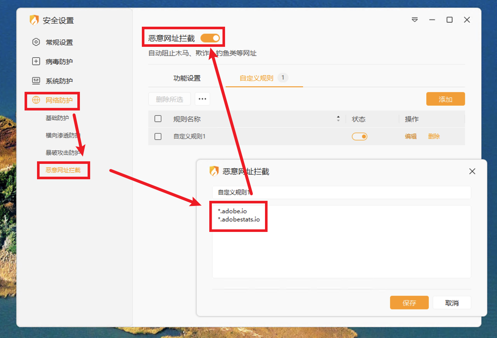
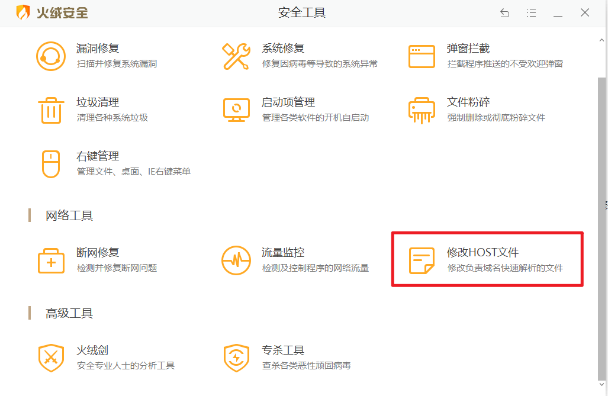

1. 卸载（AGS）Adobe Genuine Service

2. 代理软件添加以下规则  

```yml
- 'DOMAIN-SUFFIX,Adobe.io,REJECT'
- 'DOMAIN-SUFFIX,Adobestats.io,REJECT'
```

3.火绒拦截

网络防护>自定义规则：

```yml
*.Adobe.io  
*.Adobestats.io 
```



4. hosts域名屏蔽

```yml
127.0.0.1 adobe.io
127.0.0.1 adobestats.io
```



