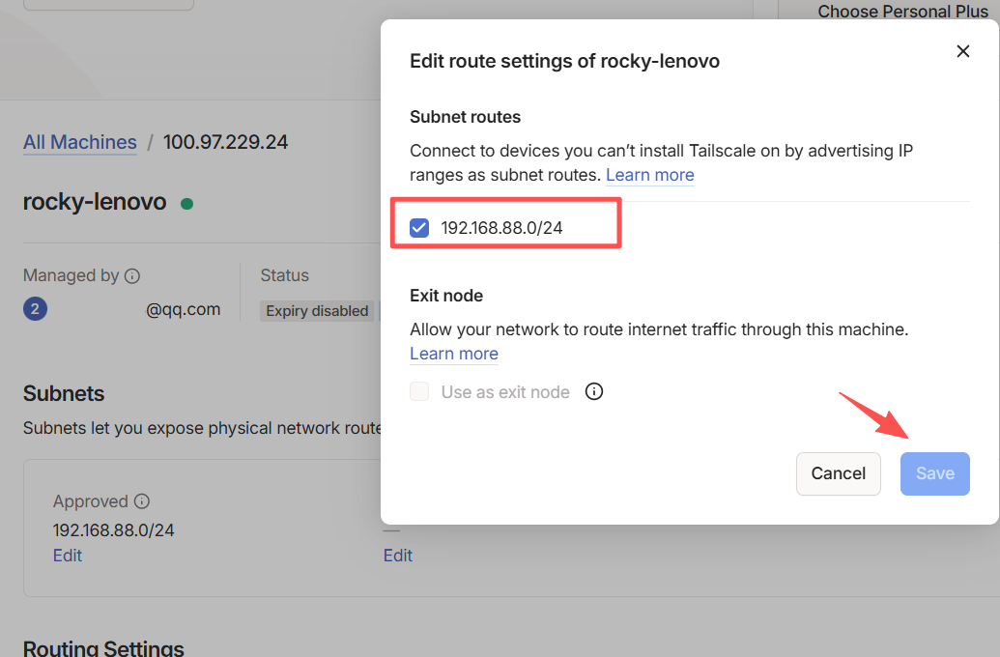
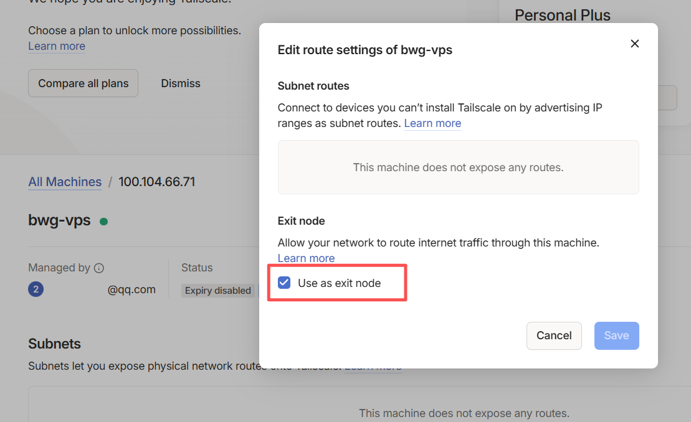

# 1. 什么是 Tailscale
## 2. [子网路由(Subnet routers)](https://tailscale.com/kb/1019/subnets) 
[Tailscale](https://tailscale.com) 是基于 WireGuard 构建的现代 VPN，通过 NAT 穿越实现设备点对点互联。

- 官方控制面板：https://login.tailscale.com/admin/machines
- 下载地址：https://tailscale.com/download


# 1. 什么是 Tailscale
[Tailscale](https://tailscale.com) 是基于WireGuard® 构建的现代 VPN，通过 NAT 穿越实现设备点对点互联。

[在线控制面板](https://login.tailscale.com/admin/machines) | [软件下载](https://tailscale.com/download/linux) | [离线安装包](https://pkgs.tailscale.com/stable/#static) | [Docker镜像](https://hub.docker.com/r/tailscale/tailscale) | [更新日志](https://tailscale.com/changelog#client)

```bash
Linux发型版安装脚本
curl -fsSL https://tailscale.com/install.sh | sh
安装后运行此命令，复制链接登录账号
tailscale up --accept-dns=false
```

-------------------------------------------------------------------------------------

## 2. [子网路由(Subnet routers)](https://tailscale.com/kb/1019/subnets) 

*子网路由用于让 Tailscale 设备访问内网非 Tailscale 设备（Tailscale充当网关）。*

2.1 Linux启用IP转发

```bash
echo 'net.ipv4.ip_forward = 1' | tee -a /etc/sysctl.d/99-tailscale.conf
echo 'net.ipv6.conf.all.forwarding = 1' | tee -a /etc/sysctl.d/99-tailscale.conf
sysctl -p /etc/sysctl.d/99-tailscale.conf
```

​### 2.2 [广告子网路由](https://tailscale.com/kb/1019/subnets#advertise-subnet-routes)

启用IP转发后，通过`--advertise-routes`设置子网路由表。逗号分隔添加多个子网。

```bash
tailscale set --advertise-routes=192.0.2.0/24,198.51.100.0/24
```

​ 2.3 [在管理控制台启用子网路由](https://tailscale.com/kb/1019/subnets#enable-subnet-routes-from-the-admin-console)



​ 2.4 在控制面板可以看到该设备被标记为<span style="background-color: lightblue; color: black;">Subnets</span>，然后在其它Linux客户端允许访问

```bash
tailscale up --accept-routes
```

​ 2.5 测试连通性`ping 192.168.88.1`

## 3. [Exit nodes出口节点](https://tailscale.com/kb/1103/exit-nodes)  

*出口节点可将所有流量通过该节点转发，实现全局代理。*

​ 3.1 Linux启用IP转发

```bash
echo 'net.ipv4.ip_forward = 1' | tee -a /etc/sysctl.d/99-tailscale.conf
echo 'net.ipv6.conf.all.forwarding = 1' | tee -a /etc/sysctl.d/99-tailscale.conf
sysctl -p /etc/sysctl.d/99-tailscale.conf
```

​ 3.2 设置VPS为Exit Node

```bash
tailscale set --advertise-exit-node && \
tailscale up --accept-dns=false
```

​ 3.3 在管理控制台允许此设备为出口节点，然后可以看到该设备被标记为<span style="background-color: lightblue; color: black;">Exit Node</span>



​ 3.4 其他客户端通过VPS转发流量,并且允许访问本地网络

```bash
tailscale set --exit-node=100.104.66.71 --exit-node-allow-lan-access=true
```

​ 3.5 停止使用出口节点，且重载配置 

```bash
tailscale set --exit-node= && \
tailscale up --reset --accept-dns=false --accept-routes
```

#### 其它开源参考
>
> [GitHub - juanfont/headscale：Tailscale 控制服务器的开源自架设实现](https://github.com/juanfont/headscale)
