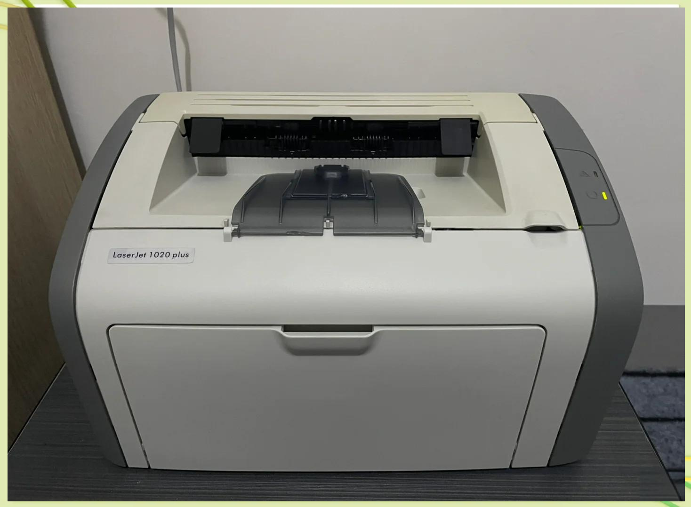
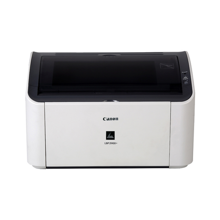
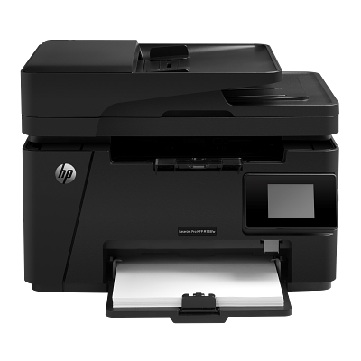

买打印机别看标价，看**总拥有成本**：机器价 + 耗材单页成本。下面按黑白、彩色两条线，只讲每台机器**值得买的理由**。

## 一、黑白激光

  

    
    
HP 1020 Plus

    
仅打印

    
一代神机。皮实耐操、12A 硒鼓极便宜，加粉续命，单页成本低到离谱。缺点是停产，只能买二手，无网络无双面。

    
二手 ¥200-400 · 单页约 0.05 元

  

  

    
    
Canon PBP2900

    
仅打印

    
同级的耐用机型，打印稳定、兼容硒鼓便宜。纯打印高性价比之选，同样停产需淘二手。

    
二手 ¥200-400 · 单页约 0.06 元

  

  

    
    
HP M128fw MFP

    
打印 + 复印 + 扫描

    
三合一，带无线和传真。家里要复印证件、扫文档就选它，一台顶三台。

    
¥900-1200 · 单页约 0.1 元

  

## 二、彩色喷墨

墨仓式（连供）色彩好、单页成本极低；缺点是喷头怕干，**必须定期使用**。

  

    
    
Epson L6468

    
打印 + 复印 + 扫描

    
商用墨仓主力，自动双面 + 有线无线，四色染墨，彩打成本低。中小办公首选。

    
¥2000 · 彩色单页约 0.1 元

  

  

    
    
Epson WF-C5890

    
打印 + 复印 + 扫描 + 传真

    
商用旗舰，速度快、纸盒大、双面 ADF，颜料墨防水耐褪色。高频彩打办公用它最省心。

    
¥4000+ · 彩色单页约 0.08 元

  

  

    
    
Canon G3820

    
打印 + 复印 + 扫描

    
佳能墨仓，照片色彩讨喜，带无线和自动进纸。要照片质感又不想花大钱，选它。

    
¥1000 · 彩色单页约 0.1 元

  

  

    
    
Epson L4266

    
打印 + 复印 + 扫描

    
家用墨仓主力，自动双面 + 液晶屏，比商用机便宜一截。家庭彩打、打作业一步到位。

    
¥1300 · 彩色单页约 0.1 元

  

  

    
    
HP M179fnw

    
彩色激光一体机

    
彩色激光，<b>不堵头</b>、速度快、文字锐利，放几个月不用也不怕。彩打少但求可靠的选它，代价是单页成本高。

    
¥2600 · 彩色单页约 0.5-0.6 元

  

## 三、一句话总结

- **黑白纯打印、省钱** → HP 1020 Plus / Canon PBP2900（皮实、加粉便宜，注意停产二手）
- **黑白要复印扫描** → HP M128fw
- **家用彩打、要照片** → Canon G3820 / Epson L4266（墨仓，注意勤用防堵头）
- **商用高频彩打** → Epson L6468 / WF-C5890（快、容量大、成本低）
- **彩打少但求可靠** → HP M179fnw 彩色激光（不堵头，单页贵）

选机器只有一个标准：**合你的使用场景**。

